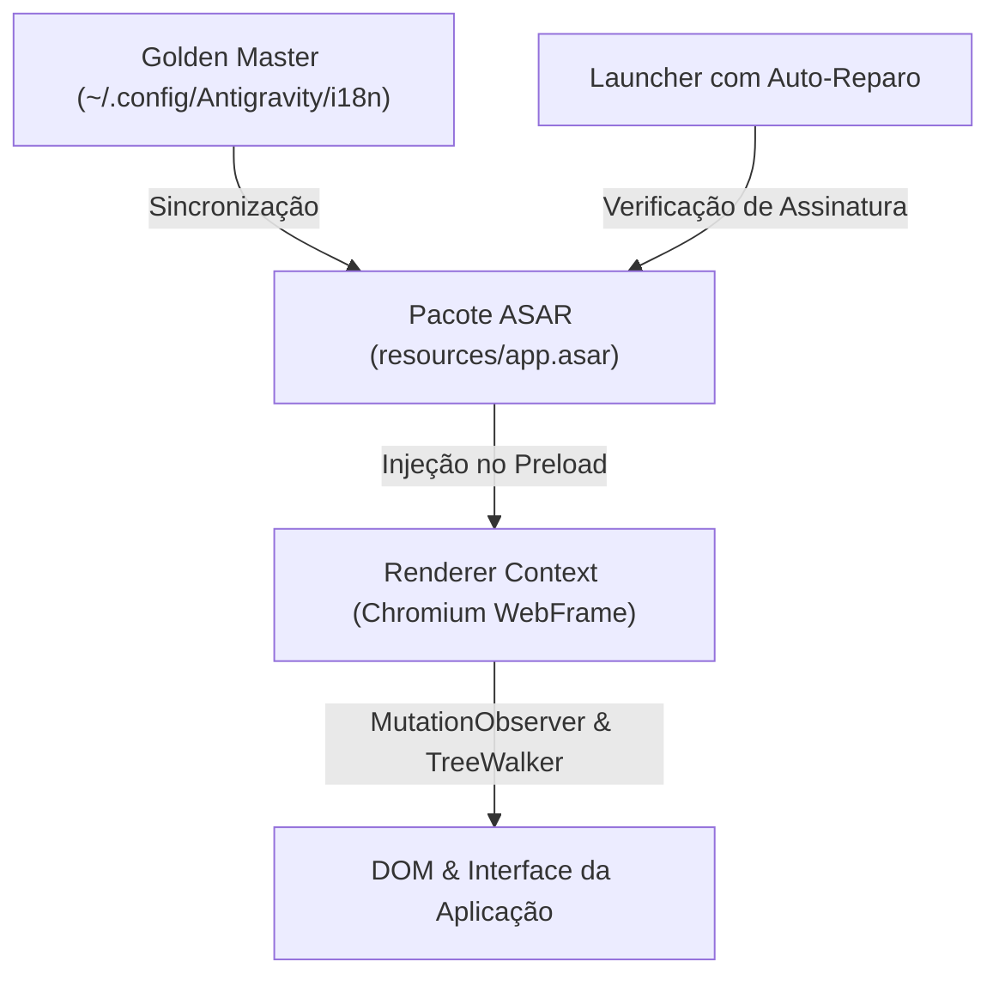

# Arquitetura e Engenharia de Localização

Este documento detalha o funcionamento interno do sistema de tradução do **Antigravity pt-BR**, suas camadas de isolamento e o modelo de persistência à prova de atualizações.

---

## 🏗️ Visão Geral em Camadas

O sistema foi estruturado em quatro camadas complementares:

---

### Camada 1: Cópia Golden Master (Persistência Independente)
- **Localização**:
  - **Linux**: `~/.config/Antigravity/i18n/i18n-pt-br.js`
  - **ChromeOS (Crostini)**: `~/.config/Antigravity/i18n/i18n-pt-br.js`
  - **macOS**: `~/Library/Application Support/Antigravity/i18n/i18n-pt-br.js`
  - **Windows**: `%APPDATA%\Antigravity\i18n\i18n-pt-br.js`
- **Função**: Atua como a fonte da verdade permanente. Como os diretórios de configuração do usuário não são sobrescritos durante atualizações do executável do Antigravity, o script de tradução permanece intacto.

---

### Camada 2: Patcher ASAR em Node.js Puro
- **Arquivo**: [`patch-asar.js`](../patch-asar.js)
- **Zero Dependências**: Não utiliza pacotes npm externos como `asar` ou `tar`. A manipulação de bytes é feita diretamente através dos módulos nativos `fs`, `path`, `crypto` e `vm` do Node.js (v18 ou superior).
- **Funcionamento Binário**:
  1. Lê o cabeçalho JSON do arquivo `app.asar`.
  2. Localiza as entradas `dist/preload.js`, `dist/utils.js`, `dist/main.js`, `dist/menu.js`, `dist/tray.js` e `dist/updater.js`.
  3. Injeta a rotina de carregamento dinâmico no `preload.js` e substitui literais em menus nativos.
  4. Recalcula os hashes de integridade SHA-256 e blocos de 4 MB para cada arquivo modificado.
  5. Alinha o cabeçalho JSON em múltiplos de 4 bytes conforme a especificação do formato ASAR do Electron.
  6. Realiza substituição atômica (`.tmp` $\rightarrow$ `renameSync`) evitando corrupção de arquivo caso o processo seja interrompido.

---

### Camada 3: Motor de Tradução no Renderer (DOM & MutationObserver)
- **Arquivo**: [`i18n-pt-br.js`](../i18n-pt-br.js)
- **Execução**: Injetado via `electron.webFrame.executeJavaScript()` logo que a janela carrega.
- **Mecanismos**:
  1. **Varredura Inicial**: Um `TreeWalker` percorre todo o DOM existente no carregamento da página.
  2. **Observação Reativa**: Um `MutationObserver` monitora adições de elementos, substituições de texto e alterações de atributos (`placeholder`, `title`, `aria-label`, `data-tooltip-content`).
  3. **Mapeamento Exato (`EXACT_MAP`)**: Dicionário serializado em memória com 2.185 chaves exatas para tradução $\mathcal{O}(1)$ instantânea.
  4. **Regras Dinâmicas (`translateDynamic`)**: Regexes e formatadores para textos contendo variáveis (números de créditos, contagem de projetos, cotas semanais/diárias, durações, datas e horas).
  5. **Proteção de Conversas**: Elementos de entrada de dados do usuário (`user-input-step`, `agent-input-box`) e áreas de código (`pre`, `code`, editor monaco) são estritamente ignorados para evitar falsos positivos linguísticos.

---

### Camada 4: Inicializador com Auto-Recuperação (Launcher)
- **Arquivo**: [`launcher/antigravity-launcher.sh`](../launcher/antigravity-launcher.sh)
- **Função**: Toda vez que o usuário executa o comando `antigravity`, o script verifica se o binário foi atualizado pela Google (verificando a assinatura de injeção `Cambrith pt-BR Localization Injection v3` dentro do `app.asar`).
- Se a assinatura estiver ausente (indicando nova versão baixada), o patcher é executado silenciosamente em frações de segundo antes de abrir o aplicativo.
